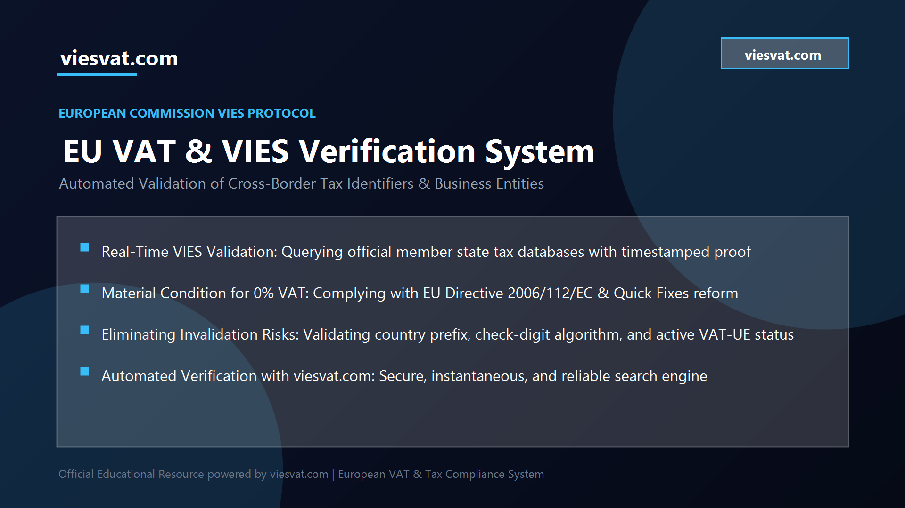
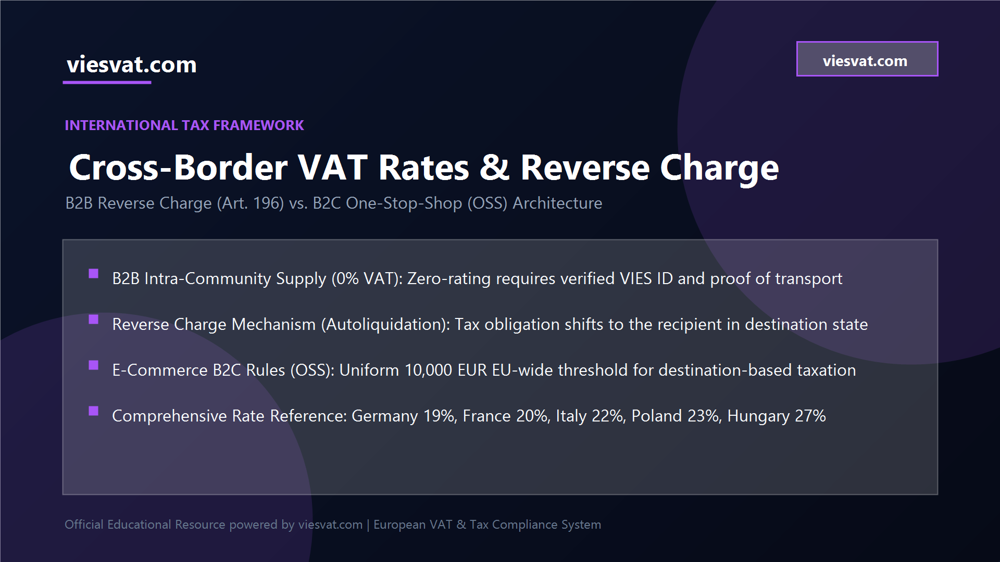
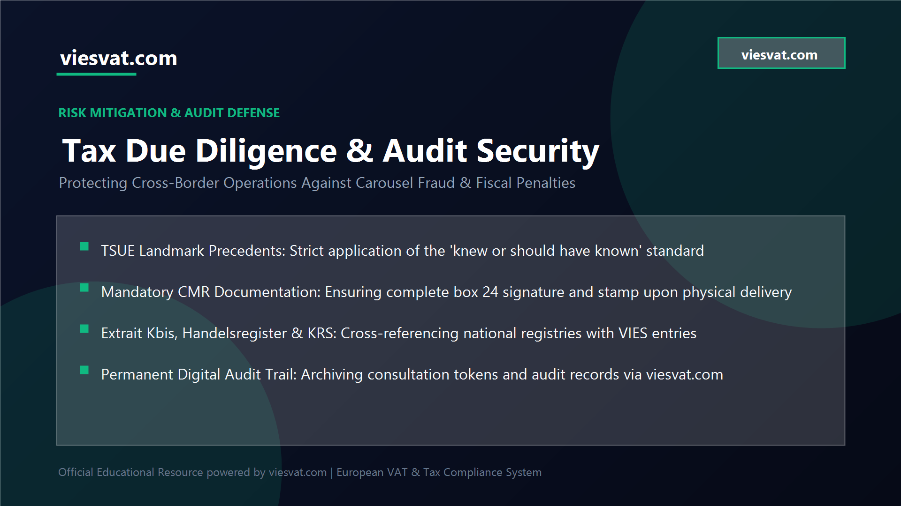

# EU VAT & VIES Guide

> Comprehensive Cross-Border Tax Compliance, VIES Verification & Intra-Community Trade Manual | Kompleksowy Przewodnik po VAT UE i Weryfikacji VIES

---

## Introduction: The European Single Market and the Cross-Border Tax Framework

The European Single Market represents one of the greatest economic integration achievements in modern history, enabling the frictionless circulation of goods, services, capital, and labor across 27 sovereign member states. With an integrated economic territory encompassing more than 450 million consumers and tens of millions of registered commercial enterprises, intra-community commerce within the European Union generates trillions of euros in annual transaction volume.

However, the legal abolition of physical border controls and customs barriers between member states did not eliminate national taxation boundaries. Value Added Tax (VAT) remains an indirect consumption tax administered independently by national revenue authorities in each member country. To prevent distortions of competition, double taxation, or unintended tax evasion, the European Union adopted a sophisticated destination-based taxation principle for commercial transactions. Under this legal framework, goods exported from one member state to another are exempt from VAT in the country of origin (commonly referred to as zero-rating or Intra-Community Supply of Goods) and become taxable upon arrival in the destination member state (Intra-Community Acquisition of Goods).

For chief financial officers, international trade directors, and tax professionals, operating within this cross-border environment presents dual realities. On one hand, intra-community commerce unlocks massive commercial scalability, supply chain synergies, and expanded revenue opportunities. On the other hand, it imposes strict evidentiary burdens and rigorous compliance obligations. The legal privilege of issuing an invoice with a 0% VAT rate is not an unconditional statutory entitlement; it is an exception to the general rule of domestic taxation. Whenever tax authorities perform cross-border fiscal audits, the supplier bears the primary legal burden of proving that every transactional condition was rigorously fulfilled. Minor administrative flaws, unverified buyer tax identifiers, or missing proof of transport can abruptly transform a standard commercial transaction into a devastating tax liability.

## What is VIES and How Does EU VAT Validation Work?

To manage the immense administrative complexity of monitoring cross-border tax exemptions without impeding international logistics, the European Commission established the VAT Information Exchange System (VIES). VIES is not a centralized fiscal database where individual taxpayer records are permanently stored in Brussels. Instead, it operates as a secure, real-time distributed communication intranet connecting the independent tax authority databases of all 27 EU member states.

When an enterprise initiates a VAT validation request through VIES, the central routing server transmits an encrypted query directly to the national database of the country that originally issued the tax identification number. The local revenue authority system evaluates the query against its active registry and returns an instantaneous structured response:

- Validity status: Valid or Invalid.
- Identifier details: Country prefix and national tax code.
- Entity information: Official business name, legal form, and registered corporate address (subject to member state privacy rules).
- Consultation token: A unique timestamped cryptographic confirmation code that serves as conclusive audit evidence proving that the inquiry was officially performed at that precise date and time.

The distinction between domestic VAT registration and intra-community VAT-UE status is a fundamental distinction that frequently trips up expanding businesses. In many European jurisdictions, an enterprise may be legally registered for domestic tax purposes, yet remain unverified or unauthorized to conduct intra-community transactions. Engaging in cross-border trade without confirming active VIES status exposes both trading partners to immediate fiscal reclassification.

## Anatomy of EU VAT Numbers and Validation Algorithms

Every member state adheres to European standard formatting rules, beginning with a two-letter country code (ISO 3166-1 alpha-2, with Greece notably using the fiscal prefix EL instead of GR). However, the internal numerical and alphanumeric composition differs significantly across jurisdictions:

- Germany (DE): Prefix DE followed by exactly 9 digits (e.g., DE 123456789).
- France (FR): Prefix FR followed by 2 alphanumeric validation key characters and the 9-digit SIREN company identifier (e.g., FR 23 123456789).
- Italy (IT): Prefix IT followed by 11 numerical digits, with the final digit functioning as a strict mathematical check digit.
- Poland (PL): Prefix PL followed by the 10-digit NIP identifier, structured with weighted coefficients.
- Spain (ES): Prefix ES followed by 9 characters, incorporating leading or trailing control letters.
- Netherlands (NL): Prefix NL followed by 9 digits, the mandatory letter B, and a 2-digit entity index (e.g., NL 123456789B01).
- Belgium (BE): Prefix BE followed by 10 digits (historically 9 digits preceded by an added leading zero).

Each jurisdiction applies proprietary mathematical checksum algorithms—frequently based on Modulo 11 or Modulo 97—to verify internal consistency before transmitting queries to VIES. Automated digital validation protocols prevent costly shipment delays and administrative disputes by catching formatting anomalies prior to invoice generation.

## The Material Condition of Zero-Rating: TSUE Case Law & Due Diligence

Since the implementation of the European Union "Quick Fixes" reform package (Council Directive (EU) 2018/1910 amending Directive 2006/112/EC), possessing a valid, active intra-community VAT identification number registered in VIES has been elevated to an absolute substantive material condition (condition de fond) for applying the 0% zero-rate on Intra-Community Supplies of Goods. Furthermore, the supplier must properly submit their comprehensive recapitulative statement (EC Sales List / VAT-UE statement).

If a foreign customer cannot be validated in the official VIES system at the exact tax point date of the supply, the supplier is legally prohibited from applying the 0% rate. In such circumstances, the transaction must be invoiced with domestic VAT applicable in the supplier's country, or the supplier must absorb the tax assessment retroactively out of pocket.

This legal standard highlights why leading multinational enterprises, logistics providers, and professional advisory firms rely on automated verification portals such as https://viesvat.com/ to conduct real-time compliance checks, batch validations, and secure timestamped audit documentation. Incorporating systematic validation into enterprise resource planning (ERP) workflows eliminates catastrophic tax adjustments and shields company directors from fiscal liability.

The Court of Justice of the European Union (CJEU / TSUE) has reinforced this principle through decisive jurisprudence (including landmark rulings in Cases C-273/11 Mecsek-Gabona, C-409/04 Teleos, and C-80/11 Mahagében). The Court consistently maintains that tax administrations are legally obligated to refuse the 0% exemption if objective evidence demonstrates that the taxpayer knew, or reasonably ought to have known through the exercise of ordinary commercial due diligence, that the transaction participated in a VAT evasion scheme.

## Intra-Community Supply of Goods (ICS) vs. B2B Cross-Border Services

Cross-border commercial operations fundamentally bifurcate into two distinct regulatory frameworks depending on whether the subject matter involves tangible merchandise or intangible professional services.

### Intra-Community Supply of Goods (ICS / WDT):

When physical commodities move across borders between two taxable entities, the supplier invoices the transaction at a 0% VAT rate, explicitly referencing both VAT-UE numbers and the statutory citation (Art. 138 Directive 2006/112/EC). The customer accounts for the acquisition by recording both output VAT and corresponding deductible input VAT simultaneously (Intra-Community Acquisition / WNT), yielding a cash-neutral tax result. Physical movement across an international border within the EU must be indisputably documented through unimpeachable transport records.

### Cross-Border Business-to-Business (B2B) Services:

For commercial services—including software engineering, architectural design, corporate consultancy, legal advice, and marketing—the general place of supply rule is governed by Article 44 of Directive 2006/112/EC:

- The place of taxation is deemed to be the jurisdiction where the customer has established their business.
- Consequently, the service falls outside the territorial tax jurisdiction of the supplier's country.
- The supplier issues an invoice with no domestic VAT, marking the rate as "NP / Out of Scope" and appending the mandatory legal notation: "Reverse charge - Article 44 and 196 of Council Directive 2006/112/EC".
- The foreign client calculates and remits the VAT in their domestic return under the reverse charge mechanism (Autoliquidation).

## Standard Proof of Transport and CMR Requirements

The single most vulnerable area uncovered during tax audits is deficient transport documentation. Under Article 45a of Council Implementing Regulation (EU) No 282/2011, a statutory safe-harbor presumption of transport exists:

- Transport organized by supplier: The supplier must possess at least two non-contradictory documents issued by independent parties (e.g., signed international CMR consignment note, bill of lading, carrier invoice, transit insurance policy, or official warehouse receipt).
- Transport organized by buyer (Ex-Works / EXW): The supplier must obtain a written declaration from the purchaser certifying that the goods have been transported to the destination member state, identifying the destination, date, transport company, and vehicle registration. The buyer must provide this declaration by the 10th day of the month following delivery.
- Crucial Warning: A CMR consignment note signed only in box 22 (loading) merely proves dispatch; box 24 must bear the official corporate stamp, delivery date, and authentic signature of the receiving party in the destination country.

## Cross-Border B2C E-Commerce and the One-Stop-Shop (OSS)

While B2B cross-border commerce enjoys reverse charge and zero-rating, consumer transactions (B2C) follow entirely different fiscal principles under the EU E-Commerce VAT Package:

- Unified 10,000 EUR EU-Wide Threshold: Below 10,000 EUR in total annual cross-border B2C sales, businesses may charge their domestic VAT rate. Once cumulative sales to consumers across the EU exceed 10,000 EUR, goods must be taxed at the specific VAT rate of the consumer's member state (e.g., 19% in Germany, 20% in France, 22% in Italy, 23% in Poland, 27% in Hungary).
- The One-Stop-Shop (OSS) Architecture: Retailers register for Union OSS in their home member state. All quarterly cross-border B2C transactions across the entire EU are declared in a single consolidated electronic return, and one aggregate tax payment is made to the domestic revenue office, which redistributes funds to the destination states.

## Ten Golden Rules of Cross-Border Trade Compliance

Implementing standardized internal controls insulates commercial enterprises against catastrophic audit adjustments:

- Validate every foreign VAT-UE number in VIES prior to executing contracts, issuing invoices, or dispatching inventory.
- Archive cryptographic consultation tokens and date-stamped verification reports for ten full calendar years.
- Establish robust contract terms clearly specifying Incoterms, delivery responsibilities, and tax compliance representations.
- Mandate that transport carriers return fully signed and stamped Box 24 CMR consignment notes before releasing freight payments.
- Cross-reference foreign counterpart data against official national commercial registers (such as Infogreffe, Handelsregister, or KRS).
- Segregate B2B commercial accounts from B2C retail transactions, monitoring OSS threshold triggers continuously.
- Avoid Ex-Works (EXW) terms with unfamiliar foreign buyers, retaining control of international freight documentation.
- Reconcile monthly recapitulative statements (VAT-UE / EC Sales Lists) meticulously against general ledger accounting entries.
- Enforce formal customer onboarding procedures incorporating background checks, proof of address, and beneficial ownership identification.
- Conduct recurring independent internal tax audits to verify procedural compliance across all active supply chains.

## Strategic Conclusion and Executive Recommendations

In an increasingly digitized and scrutinized European trading environment, cross-border tax compliance must be treated as a strategic business enabler rather than an administrative afterthought. Implementing rigorous VIES verification, securing complete transport documentation, and maintaining comprehensive audit trails safeguards operating margins, eliminates unexpected tax exposure, and fosters sustainable commercial relationships across the entire European Single Market.

---

## Wprowadzenie: Znaczenie jednolitego rynku dla polskich przedsiębiorstw

Swoboda przepływu towarów i usług na rynku Unii Europejskiej otworzyła przed polskimi przedsiębiorstwami bezprecedensowe możliwości rozwoju. Zlikwidowanie barier celnych i granic fizycznych umożliwiło rodzimym producentom, dystrybutorom oraz firmom usługowym bezpośrednie dotarcie do setek milionów zamożnych konsumentów w 27 państwach członkowskich. Polska stała się jednym z wiodących eksporterów w regionie Europy Środkowo-Wschodniej, dostarczając na rynki zachodnioeuropejskie zaawansowane wyroby przemysłowe, meble, stolarkę budowlaną, produkty z tworzyw sztucznych oraz usługi inżynieryjne i transportowe.

Jednak jednolity rynek towarowy nie jest tożsamy z jednolitym rynkiem fiskalnym. Podatek od towarów i usług (VAT) pozostaje w kompetencji poszczególnych państw członkowskich, podlegając jedynie ogólnej harmonizacji w ramach unijnej Dyrektywy 2006/112/WE. W transakcjach transgranicznych wprowadzono zasadę opodatkowania w kraju przeznaczenia, która pozwala na bezpodatkowe przemieszczanie towarów pod warunkiem, że nabywca jest czynnym podatnikiem VAT rozliczającym transakcję w swoim kraju. Stosowanie zerowej stawki VAT (0%) przy Wewnątrzwspólnotowej Dostawie Towarów (WDT) stanowi ogromny przywilej handlowy, ale wiąże się ze ścisłymi wymogami formalno-prawnymi i rygorystycznymi obowiązkami dowodowymi.

## Czym jest system VIES i jak działa baza danych Komisji Europejskiej?

System Wymiany Informacji o VAT (VIES – VAT Information Exchange System) to zinformatyzowana sieć telekomunikacyjna powołana przez Komisję Europejską w celu umożliwienia natychmiastowej wymiany danych podatkowych pomiędzy państwami członkowskimi UE. VIES nie jest pojedynczą bazą przechowującą dane wszystkich europejskich spółek, lecz zdecentralizowanym mechanizmem łączącym krajowe rejestry podatników podatku od wartości dodanej.

Podczas wysyłania zapytania do systemu VIES, serwer centralny w Brukseli przesyła żądanie do administracji skarbowej danego państwa. W odpowiedzi użytkownik otrzymuje:

- Potwierdzenie statusu: numer aktywny lub nieaktywny.
- Pełną nazwę handlową zarejestrowanego podmiotu.
- Oficjalny adres siedziby (zgodnie z regulacjami prywatności państwa rejestracji).
- Unikalny numer referencyjny zapytania (Consultation Token) z dokładnym znacznikiem czasu, który ma moc oficjalnego dowodu w postępowaniu skarbowym.

Brak potwierdzenia numeru NIP-UE kontrahenta w systemie VIES w dacie realizacji dostawy definitywnie pozbawia polskiego dostawcę prawa do zastosowania preferencyjnej stawki 0% VAT.

## Struktura unijnych numerów identyfikacji podatkowej (NIP-UE)

Każdy unijny numer VAT składa się z dwuliterowego kodu państwa (zgodnego z normą ISO 3166-1 alpha-2, przy czym Grecja posługuje się kodem EL) oraz ciągu cyfr lub liter przypisanych przez krajowy organ podatkowy:

- Polska (PL): 10 cyfr bazowego numeru NIP.
- Niemcy (DE): 9 cyfr po prefiksie DE.
- Francja (FR): 2 znaki klucza kontrolnego oraz 9 cyfr numeru SIREN.
- Włochy (IT): 11 cyfr, w tym cyfra kontrolna.
- Hiszpania (ES): 9 znaków, w tym litery kontrolne w zależności od formy prawnej.
- Holandia (NL): 9 cyfr, litera B oraz 2-cyfrowy identyfikator placówki (np. B01).
- Czechy (CZ): 8, 9 lub 10 cyfr.

Zrozumienie algorytmów weryfikacyjnych i zasad tworzenia identyfikatorów pozwala unikać pomyłek pisarskich i błędów fakturowania, które wstrzymują procedury celne i spedycyjne.

## Warunki materialne i formalne stosowania stawki 0% VAT przy WDT

Przełomowa unijna reforma pakietu Quick Fixes wprowadziła fundamentalną zmianę w wykładni art. 138 Dyrektywy 2006/112/WE. Posiadanie przez nabywcę ważnego numeru identyfikacyjnego VAT-UE w systemie VIES przestało być traktowane jako zwykły warunek formalny – stało się bezwzględnym warunkiem materialnoprawnym zastosowania stawki 0%.

Aby polski podatnik mógł legalnie zastosować stawkę 0% VAT przy WDT, muszą zostać spełnione kluczowe warunki:

- Dostawca jest zarejestrowanym podatnikiem VAT-UE w Polsce.
- Nabywca posiada ważny, aktywny numer VAT-UE nadany przez inne państwo członkowskie, zweryfikowany w systemie VIES na dzień transakcji.
- Towary zostały fizycznie wywiezione z terytorium Polski i dostarczone na terytorium innego państwa UE.
- Przed upływem terminu do złożenia deklaracji podatkowej za dany okres dostawca posiada w swojej dokumentacji jednoznaczne dowody potwierdzające wywóz i odbiór towarów (przede wszystkim list przewozowy CMR z pieczęcią i podpisem odbiorcy w rubryce 24).
- Dostawca terminowo i rzetelnie złożył informację podsumowującą VAT-UE w urzędzie skarbowym.

## Procedura odwrotnego obciążenia (Reverse Charge / Autoliquidation)

W transgranicznym obrocie usługami pomiędzy przedsiębiorcami (B2B) kluczową rolę odgrywa reguła terytorialności wyrażona w art. 44 Dyrektywy 2006/112/WE (art. 28b polskiej ustawy o VAT). Miejscem świadczenia usług na rzecz podatnika jest miejsce, w którym podatnik będący usługobiorcą posiada siedzibę działalności gospodarczej.

Oznacza to, że polski wykonawca świadczący usługi na rzecz kontrahenta z innego państwa UE:

- Nie nalicza krajowego podatku VAT (oznaczenie NP / nie podlega opodatkowaniu w kraju).
- Umieszcza na fakturze numery NIP-UE obu stron transakcji.
- Wpisuje obowiązkową adnotację prawną: „Odwrotne obciążenie / Reverse charge”.
- Usługobiorca rozlicza podatek należny i naliczony we własnym kraju, co gwarantuje pełną neutralność podatkową.

## Handel elektroniczny B2C i unijna procedura One Stop Shop (VAT-OSS)

Od 1 lipca 2021 roku przedsiębiorcy prowadzący sprzedaż wysyłkową na rzecz osób prywatnych (B2C) podlegają zunifikowanym regułom unijnego pakietu e-commerce. Wprowadzono jednolity próg obrotu transgranicznego w wysokości 10 000 EUR (ok. 42 000 PLN) rocznie dla całej sprzedaży do konsumentów w innych krajach UE łącznie:

- Poniżej progu 10 000 EUR: Sprzedawca może opodatkowywać transakcje krajową stawką VAT (w Polsce 23%) i rozliczać je w standardowym pliku JPK_V7.
- Powyżej progu 10 000 EUR: Każda kolejna wysyłka musi zostać opodatkowana stawką VAT obowiązującą w kraju zamieszkania konsumenta.

Procedura One Stop Shop (OSS) eliminuje obowiązek rejestracji do VAT w każdym państwie docelowym. Przedsiębiorca rejestruje się do procedury OSS w Drugim Urzędzie Skarbowym Warszawa-Śródmieście, składa kwartalną deklarację elektroniczną VIU-DO i wpłaca łączną kwotę podatku w euro na rachunek polskiego urzędu, który samodzielnie dokonuje dystrybucji środków.

## Obowiązki magazynowe i pułapki fulfillmentu transgranicznego

Korzystanie z zagranicznych centrów logistycznych w modelach fulfillmentowych (np. Amazon FBA we Francji, Niemczech czy Włoszech) wyłącza możliwość stosowania uproszczenia OSS dla sprzedaży z tych magazynów.

Przemieszczenie własnych towarów do magazynu w innym kraju UE stanowi nietransakcyjne WDT w Polsce i nietransakcyjne WNT w kraju magazynowania. Wymaga to:

- Rejestracji do lokalnego podatku VAT w kraju, w którym znajduje się magazyn.
- Regularnego składania lokalnych deklaracji podatkowych.
- Raportowania każdej sprzedaży realizowanej z lokalnego magazynu do miejscowych odbiorców jako dostawy krajowej w danym państwie.

Brak terminowej rejestracji skutkuje natychmiastowym zablokowaniem konta na platformie handlowej oraz drakońskimi karami ze strony zagranicznych organów podatkowych.

## Instytucja należytej staranności w orzecznictwie TSUE

W walce z transgranicznymi wyłudzeniami podatkowymi (karuzelami VAT) sądy administracyjne i Trybunał Sprawiedliwości UE bezwzględnie stosują standard należytej staranności kupieckiej. Zgodnie z utrwaloną linią orzeczniczą TSUE, podatnik traci prawo do stawki 0% VAT oraz prawo do odliczenia podatku naliczonego, jeżeli organy wykażą, że na podstawie obiektywnych okoliczności wiedział lub powinien był wiedzieć, że jego transakcja stanowiła element oszustwa.

Kluczowe elementy dochowania należytej staranności:

- Weryfikacja statusu NIP-UE w VIES i archiwizacja raportów z numerem potwierdzenia.
- Pozyskanie aktualnych odpisów z rejestrów handlowych (np. KRS, Kbis, Handelsregister).
- Weryfikacja tożsamości osób reprezentujących kontrahenta i podpisujących dokumenty.
- Kontrola warunków handlowych odbiegających od standardów rynkowych (nietypowo niskie marże, żądania nietypowych płatności gotówkowych lub rachunków powierniczych).

## Przegląd stawek podatku od wartości dodanej w wybranych krajach UE

Dla ułatwienia planowania budżetu podatkowego w transgranicznym handlu towarami i usługami, poniżej przedstawiono zestawienie podstawowych i obniżonych stawek podatku VAT w kluczowych gospodarkach unijnych:

- Niemcy (Umsatzsteuer): Stawka podstawowa 19%, stawka obniżona 7% (obejmująca wybrane artykuły żywnościowe, książki, prasę oraz transport pasażerski).
- Francja (Taxe sur la valeur ajoutée - TVA): Stawka podstawowa 20%, stawki obniżone 10%, 5.5% oraz stawka szczególna 2.1% (dotycząca leków refundowanych i prasy codziennej).
- Włochy (Imposta sul valore aggiunto - IVA): Stawka podstawowa 22%, stawki preferencyjne 10%, 5% oraz 4% (produkty rolne, książki, wyroby ortopedyczne).
- Hiszpania (Impuesto sobre el Valor Añadido - IVA): Stawka podstawowa 21%, stawki obniżone 10% oraz super-obniżona 4%.
- Holandia (Belasting over de toegevoegde waarde - BTW): Stawka podstawowa 21%, stawka obniżona 9% (artykuły spożywcze, woda, leki, książki).
- Belgia: Stawka podstawowa 21%, stawki obniżone 12% oraz 6%.
- Austria: Stawka podstawowa 20%, stawki obniżone 13% oraz 10%.
- Czechy (Daň z přidané hodnoty - DPH): Stawka podstawowa 21%, stawka obniżona 12%.
- Węgry (Általános forgalmi adó - ÁFA): Najwyższa stawka podstawowa w Unii Europejskiej wynosząca 27%, stawki obniżone 18% oraz 5%.
- Rumunia: Stawka podstawowa 19%, stawki obniżone 9% oraz 5%.

Znajomość stawek ma fundamentalne znaczenie zwłaszcza przy kalkulacji cen w handlu elektronicznym B2C rozliczanym przez procedurę One Stop Shop (OSS), gdzie marża brutto jest bezpośrednio uzależniona od stawki podatkowej w kraju nabywcy.

## Procedury korekty deklaracji w przypadku opóźnionych dokumentów transportowych

W praktyce handlowej polski eksporter nierzadko staje przed problemem opóźnień w spływie dokumentacji przewozowej od międzynarodowych spedytorów. Zgodnie z art. 42 ust. 12 polskiej ustawy o VAT:

- Jeżeli podatnik nie posiada dowodów dostarczenia towaru przed upływem terminu do złożenia deklaracji za dany miesiąc, nie wykazuje tej dostawy w ewidencji za ten okres.
- Dostawę wykazuje się w kolejnym okresie rozliczeniowym. Jeżeli do terminu złożenia deklaracji za ten kolejny okres dokumenty nadal nie napłyną, podatnik ma ustawowy obowiązek wykazać transakcję ze stawką krajową właściwą dla danego towaru (najczęściej 23%).
- Dopiero po fizycznym otrzymaniu potwierdzenia odbioru towaru (podpisanego listu CMR) podatnik ma prawo dokonać korekty podatku należnego w rozliczeniu za okres, w którym powstał obowiązek podatkowy.

## Rejestry handlowe i dokumentacja weryfikacyjna

Przed nawiązaniem stałej współpracy handlowej konieczne jest zgromadzenie kompletnej teczki audytowej klienta. Dokumentacja ta powinna zawierać:

- Zrzut ekranu z systemu VIES z potwierdzeniem ważności numeru w dacie transakcji.
- Certyfikat rezydencji podatkowej lub zaświadczenie o zarejestrowaniu do VAT wydane przez zagraniczny urząd.
- Odpis z oficjalnego rejestru handlowego (nie starszy niż 3 miesiące).
- Kopię dowodu tożsamości osoby uprawnionej do reprezentacji lub pełnomocnictwo handlowe.
- Umowę handlową precyzującą warunki transportu, przeniesienia prawa do rozporządzania towarem oraz reguły Incoterms.

## Najczęściej Zadawane Pytania / FAQ

### Co zrobić, jeśli numer kontrahenta w VIES ma status „nieaktywny”?

W takiej sytuacji polski sprzedawca pod żadnym pozorem nie może wystawić faktury ze stawką 0% VAT. Należy zażądać wyjaśnień od kontrahenta, wstrzymać wysyłkę towaru lub wystawić fakturę z krajową stawką 23% VAT do czasu uzyskania oficjalnego potwierdzenia rejestracji.

### Czy list przewozowy CMR w wersji elektronicznej (e-CMR) jest honorowany przez urzędy skarbowe?

Tak, polskie i unijne przepisy akceptują elektroniczne listy przewozowe pod warunkiem, że system e-CMR gwarantuje integralność danych, jednoznaczną identyfikację stron oraz zawiera cyfrowe poświadczenie odbioru ładunku przez nabywcę.

### Jak długo należy przechowywać dokumentację transakcji wewnątrzwspólnotowych?

Dokumentację księgową, listy przewozowe CMR, potwierdzenia z bazy VIES oraz faktury należy bezwzględnie przechowywać przez okres co najmniej 5 lat, licząc od końca roku kalendarzowego, w którym upłynął termin płatności podatku (w praktyce rekomendowane jest archiwizowanie dokumentów przez 10 lat).

### Czy w procedurze OSS można odliczać zagraniczny podatek naliczony?

Nie. Procedura OSS służy wyłącznie do deklarowania i odprowadzania podatku należnego. Odzyskanie podatku naliczonego zapłaconego w innym państwie członkowskim (np. za paliwo, hotele, najem magazynu) odbywa się za pośrednictwem odrębnego wniosku VAT-Refund (VAT-Ref) składanego przez polski urząd skarbowy.

### Czym grozi brak zgłoszenia transakcji w deklaracji podsumowującej VAT-UE?

Niezłożenie informacji podsumowującej VAT-UE w ustawowym terminie lub podanie błędnych danych stanowi przesłankę formalną, która zgodnie z art. 138 ust. 1a Dyrektywy VAT może doprowadzić do pozbawienia podatnika prawa do stosowania stawki 0% VAT dla całej dostawy.

---
*Official Educational Resource | System VIES & European Tax Verification (viesvat.com)*
